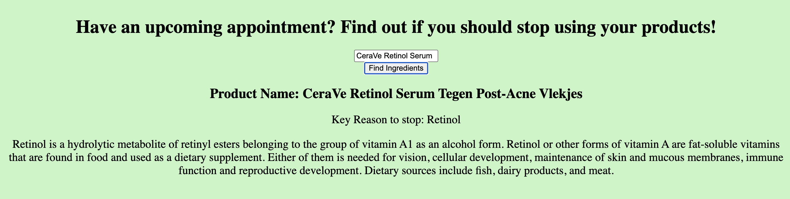

# Med Spa Product Checker

Enter a beauty product and find out if you should stop using it before a med spa appointment.

Live Link: https://tbrown320.github.io/complex-api-med-spa/



## What it does

- Takes a beauty product name and looks up its ingredients with the Open Beauty Facts API.
- Checks the ingredients against a list of ingredients to pause before treatment: Retinol, Retinyl palmitate, Glycolic acid, Salicylic acid, Lactic acid, and Benzoyl peroxide.
- If one is found, shows the product name, the flagged ingredient(s), and a short explanation of the first one from the Wikipedia API.
- If nothing is found, it says so — either no flagged ingredients, no ingredient list yet, or the product could not be found.

Try it with: CeraVe Retinol Serum, CeraVe SA Smoothing Cleanser, or CeraVe Moisturizing Cream.

## Tech stack

- HTML, CSS, JavaScript (no build step, no server)
- Open Beauty Facts API — product and ingredient lookup
- Wikipedia REST API — summary of the flagged ingredient

## How to run it

Open `index.html` in a browser, type a product name, and click **Find Ingredients**. No API key or install step is needed.

## Project structure

```
index.html      - product input, button, and the results section
css/style.css   - page styling
js/main.js      - ingredient lookup, flagged-ingredient check, Wikipedia fetch
```

---

Thay Brown — thaybrown22@gmail.com · https://thaythecoder.netlify.app · https://github.com/tbrown320 · https://www.linkedin.com/in/thaybrown
