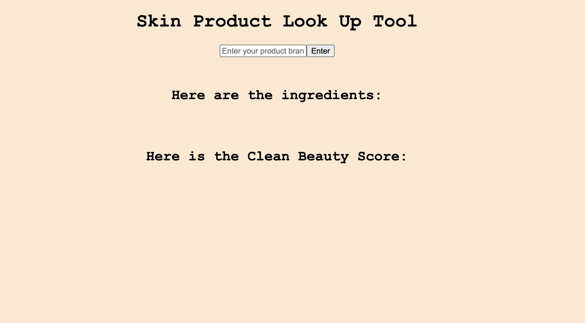
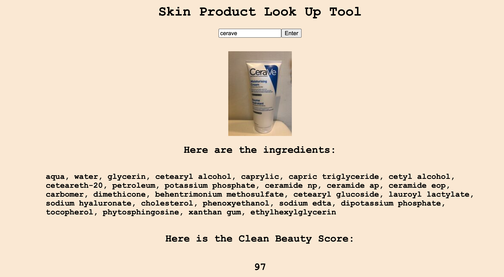

#  Med Spa Product Safety Checker

A front-end web app for a med spa that chains two APIs. Enter a skincare product name, and the app finds the product on Open Beauty Facts, then uses its barcode to fetch safety information from the INCI API. Staff and clients can quickly check a product before using it.
- Check out here: 
 https://med-spa-git-answer-rc-09fb.vercel.app/

- screenshots:



## Features

- Search skincare products by name
- Look up safety information for the matched product
- Chained API calls: the product code from the first API feeds the request to the second

## How It Works

1. The user enters a product name
2. The app searches the **Open Beauty Facts** API and gets the product `code`
3. It uses that `code` to call the **INCI API**:
   ```javascript
   `https://inciapi.com/v1/products/${code}/safety`
   ```
4. The safety results are displayed on the page

## Built With

- HTML5
- CSS3
- JavaScript (Fetch API)
- [Open Beauty Facts API](https://world.openbeautyfacts.org/data): product search
- [INCI API](https://inciapi.com): product safety data

## Getting Started

1. Clone the repo and switch to the `answer` branch
   ```bash
   git clone https://github.com/sabrinalindev/med-spa.git
   cd med-spa
   git checkout answer
   ```
2. Get an API key from the [INCI API](https://inciapi.com) and add it in `js/main.js`
3. Open `index.html` in your browser

> **Note:** This is a front-end project, so any API key in `js/main.js` is visible to anyone who opens the site. Use a free or restricted key only.

## Disclaimer

This project is for learning and general information only. It is not medical advice. Consult a licensed professional before making skincare decisions.

## What I Learned

- How to make one API request depend on the result of another
- How to build request URLs with template literals
- How to use `fetch` with promises or `async/await`
- How to display data from multiple API responses on the page

## Credit

- Challenge from [Resilient Coders](https://github.com/Resilient-Labs/complex-api-med-spa)
- Contains data from [Open Beauty Facts](https://world.openbeautyfacts.org/), available under the [Open Database License (ODbL)](https://opendatacommons.org/licenses/odbl/1.0/)