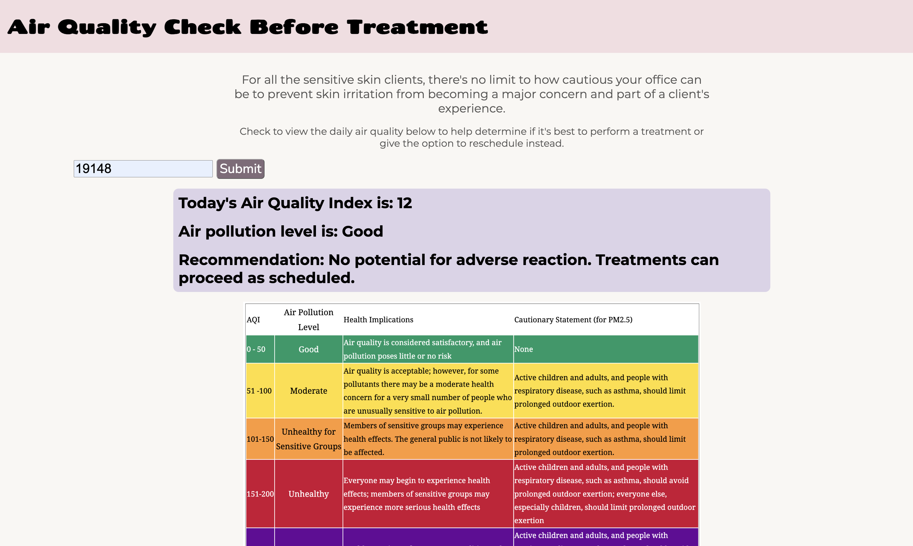

# 👩🏾‍⚕️ Med Spa App

A tool for med spas that want to ensure that their clients don't run into any skin irritation issues post-procedure. Using the air quality index of the day in the user's area of interest, this application shares general recommendations for procedure confirmations. Built with plain HTML, CSS, and JavaScript.

### Project Description

One way to stand out as a Med Spa is the quality of care and not just for clients during their procedures but also before and after. This project is meant to be used as a tool for med spas that are doing their due diligence to prevent their clients from running into any skin irritation issues post-procedure. Using the air quality index of the day in the user's area of interest, this application shares general recommendation. 

I used a geocoding API that takes in a zipcode and returns the latituded and longitude for that zipcode. I then used those coordinates as an input into the air quality API that prints the air quality index to the web page. I also included recommendations to take at different air quality index levels.

### Live Link 
To access the link, check the about section of this repo or [CLICK HERE](https://priscilla-ruilova.github.io/Med-Spa-App/).



### Features:

- **Treatment menu** — each service is displayed in its own card with a name, description, and price.
- **Booking form** — clients pick a service, a date, and a time, and submit a request.
- **Form validation** — the form won't submit until every field is filled, with a message shown when something is missing.
- **Confirmation message** — a summary of the requested appointment appears after submitting.
- **Responsive layout** — cards and the form reflow into a single column on smaller screens.
- **Two data sources** — treatment details come from an API, and the booking request is sent to a separate endpoint.
- **Custom styling** — a hand-written stylesheet in `assets/styles.css` and a Google Fonts stack.

### Tech Used:

- **Frontend:** HTML, CSS, JavaScript (vanilla, no framework)
- **APIs:** /api.geocod.io/v2/geocode to get latitude and longitude coordinates using the zipcode input as a query parameter; api.waqi.info/feed/geo to get the air quality index using latitude and longitude. 
- **Layout:** CSS flexbox
- **Hosting:** GitHub Pages

### Things I Learned:

- Working with two APIs:
  - How to build a request URL with template literals so a search term enters the query string.
  - How to chain `fetch(url)` → `.then(res => res.json())` → `.then(data => ...)` and read values out of the response.
  - Handling failed requests with `.catch()` and show the user a message rather than failing silently — and why one API failing shouldn't blank out the results from the other.
- Debugging:
  - Reading the browser's Network tab to see the actual request URL, method, and status code when a fetch doesn't return what I expected.
  - Checking each API's docs separately — query parameter names and rate limits differ between providers, and a 401 from one says nothing about the other. Writing documentation is an art and some APIs were harder to read than others...

### How to Use:

1. Clone this repository:
```bash
git clone https://github.com/priscilla-ruilova/Med-Spa-App.git
```

2. Navigate to the project:
```bash
cd Med-Spa-App
```

3. Open `index.html` in your browser — no install step needed.

4. Make it your own!
- Swap in your own API key in `assets/main.js`.
- Try changing the styling in `assets/styles.css` to make it your own.

## Happy Coding!