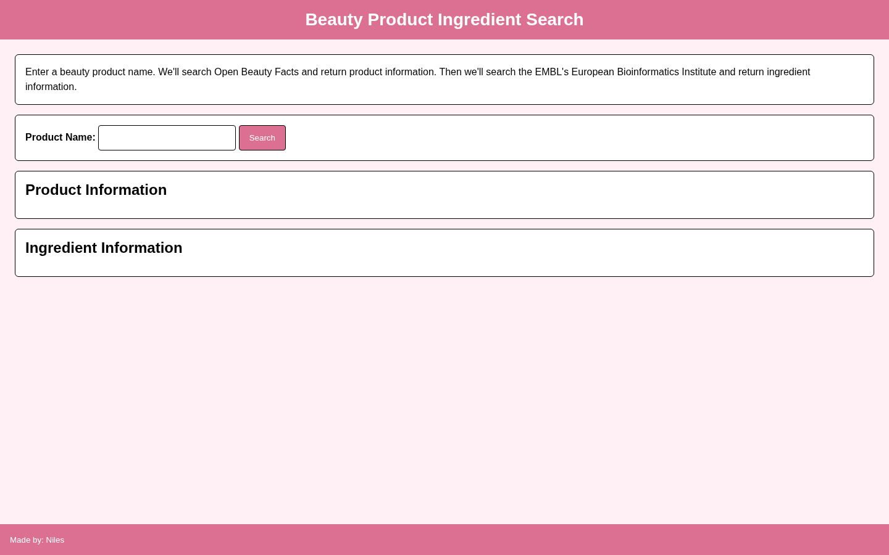

# Beauty Product Ingredient Information

Search beauty products and combine ingredient data from Open Beauty Facts with chemical information from ChEBI.

## Overview

Beauty Product Ingredient Information lets a user search for a beauty product by name.

The application retrieves product and ingredient data from Open Beauty Facts. For each available ingredient, it then queries ChEBI to retrieve additional chemical information and displays the combined results in the browser.

## Features

- Search for a beauty product by name
- Retrieve product and brand information
- Display the product ingredient list
- Use returned ingredients to make additional API requests
- Retrieve available chemical names, ChEBI identifiers, and descriptions
- Handle products without ingredient information
- Combine data from two external APIs in one interface

## Technologies

<p>
  <a href="https://developer.mozilla.org/en-US/docs/Web/HTML" title="HTML">
    
  </a>
  &nbsp;
  <a href="https://developer.mozilla.org/en-US/docs/Web/CSS" title="CSS">
    
  </a>
  &nbsp;
  <a href="https://developer.mozilla.org/en-US/docs/Web/JavaScript" title="JavaScript">
    
  </a>
</p>

- [Open Beauty Facts](https://world.openbeautyfacts.org/)
- [ChEBI](https://www.ebi.ac.uk/chebi/)

## How to Run

1. Clone the repository:

```bash
git clone https://github.com/nilesleesmith/simply-get-beauty-product-ingredient-information.git
```

2. Open the project folder.

3. Open `index.html` in a web browser.

No additional packages or build steps are required.

## Live Site

https://nilesleesmith.github.io/simply-get-beauty-product-ingredient-information/

## Screenshots

