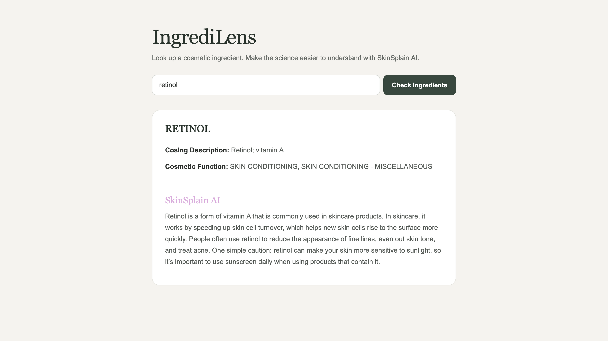

# 👩🏾‍⚕️ Project: Complex API 2 - Med Spa

### Goal: Build a simple front-end app that uses data returned from one api to make a request to another api to create something that would be beneficial to a Med Spa.

### How to submit your code for review:

- Fork and clone this repo
- Create a new branch called answer
- Checkout answer branch
- Push to your fork
- Issue a pull request
- Your pull request description should contain the following:
  - (1 to 5 no 3) I completed the challenge
  - (1 to 5 no 3) I feel good about my code
  - Anything specific on which you want feedback!

Example:
```
I completed the challenge: 5
I feel good about my code: 4
I'm not sure if my constructors are setup cleanly...
```

---

## My Solution

**IngrediLens + SkinSplain** is a front-end application that allows users to search for cosmetic ingredients and receive easier-to-understand information about them.

The application takes a cosmetic ingredient entered by the user, retrieves ingredient information through an API, and uses that returned data to generate a clearer explanation designed to make cosmetic science more accessible and useful.



## How It's Made

**Tech used:** HTML, CSS, JavaScript, APIs

The application accepts a cosmetic ingredient through the search interface and makes an API request for information about that ingredient. The returned data is then used in a second request to generate a more accessible explanation, demonstrating how data from one API can be used as input for another API.

## What I Learned

This project gave me additional practice working with multiple APIs, using returned API data in subsequent requests, handling asynchronous JavaScript, processing dynamic user input, and rendering returned information to the DOM.