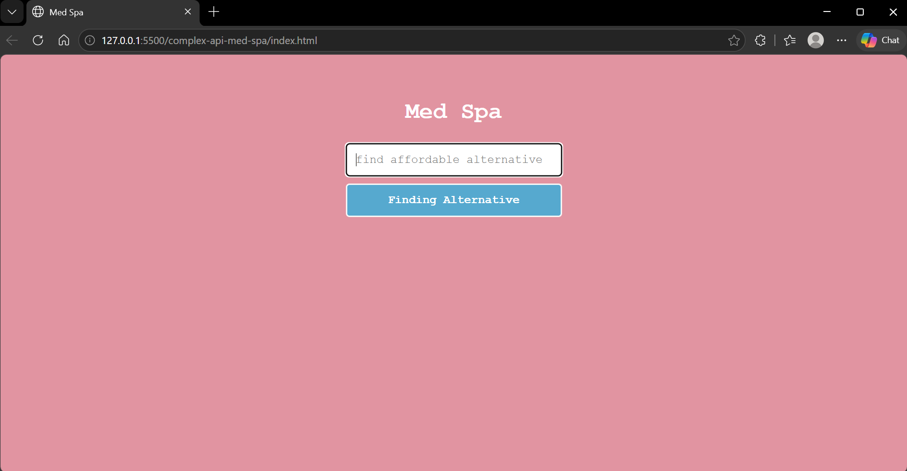
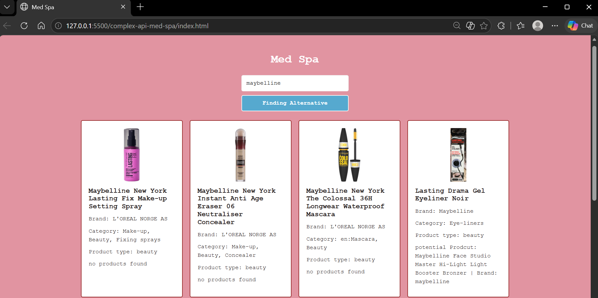

# Med Spa
Goal: Build a simple front-end app that uses data returned
from one api to make a request to another api to create 
something that would be beneficial to a Med Spa.

Main github repo: https://github.com/KinzaRehman/complex-api-med-spa.git

## View

  
  

## Limits 
-Key word sensitive. Data limitations
## Built With

- HTML5
- CSS3
- Vanilla JavaScript

## Local Preview

Open `index.html` using the VS Code Live Server extension or open the file directly in your browser.

## Before Publishing

This is an opensource APi, test and read the documentation.
